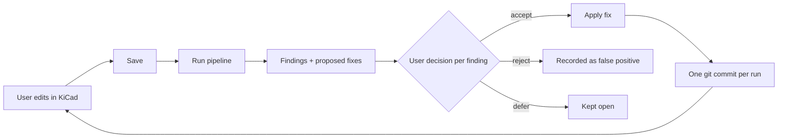

# Architecture

## Goal

Help design PCBs in KiCad faster and with as few errors as possible. The pipeline
follows the real design flow: define the product, design the architecture on paper,
draw the schematic, draw the layout. At each phase it checks the work, explains the
problems it finds and proposes fixes.

## Principles

1. **KiCad is where the design happens.** The user draws the schematic and the layout
   in KiCad. The pipeline reads the KiCad files (through `kicad-cli` and the S-expression
   files) and, when a fix is accepted, edits them.
2. **The spec is the reference.** Phase 1 produces `design/spec.yaml`, the single
   source of truth for design intent. Every later check compares the KiCad design to
   it. The PDF is generated from the YAML, never the other way around.
3. **Python computes, the LLM judges.** Anything that can be checked mechanically
   (pins, derating, equations, absolute maximum ratings, I2C conflicts, power budget)
   is deterministic Python. Agents handle datasheet notes, edge cases and intent.
4. **No proof, no finding.** Every finding cites a datasheet page, a net, a spec entry
   or a calculation. This is enforced by `schemas/findings.schema.json`.
5. **Nothing changes without the user's agreement.** The pipeline proposes, the user
   decides, the pipeline applies.
6. **Reusable and self-improving.** The pipeline repo holds everything that is shared
   across projects (rules, agent prompts, component sheets, schemas, templates). Every
   project feeds lessons back into it.
7. **Reuse before rebuilding.** kicad-happy, pcbsight, ngspice and LTspice are
   integrated rather than reimplemented.

## Working loop

The pipeline does not run while the user is editing. The user works in KiCad, stops,
saves, and runs the pipeline:

Rules for applying fixes:

- The project tree must be clean in git before applying, so every applied change is a
  separate commit that can be reverted.
- The pipeline warns if KiCad still has the file open (lock file) and asks the user to
  close it or reload it after the change.
- Each fix has a `kind` (see the findings schema). Simple, local changes are applied
  automatically: symbol fields (MPN, Voltage, Tolerance), values, footprints, spec
  entries. Topology changes (adding a part, rewiring) start as precise instructions for
  the user, and become automatic once editing the schematic file is proven reliable.
- Every decision is written to `review/decisions.yaml` (see the learning loop).

## Project repo layout

The pipeline is a separate tool. Each board has its own repo:

| Path | Content |
|---|---|
| `inputs/` | Documents given by the user: client spec, notes, sketches, reference designs |
| `design/prd.md` | Product requirements, written in phase 0 |
| `design/spec.yaml` | Architecture and design rules, written in phase 1 |
| `design/spec.pdf` | Generated from `spec.yaml` |
| `datasheets/` | Local datasheets `{mpn}@{revision}.pdf`, not committed (size, copyright) |
| `datasheets/index.yaml` | Committed: MPN, URL, revision, date, sha256 |
| `kicad/` | The KiCad project |
| `review/` | One folder per run (findings, report), plus `decisions.yaml` and `missed.yaml` |

## Phases

### Phase 0: product definition

The user gives documents to the `interviewer` agent (in `inputs/`), then they discuss.
The agent works from `knowledge/phase0_questions.md`, the shared list of questions and
data it needs (function, power, interfaces, mechanical, environment, standards,
manufacturing, reliability). Each question has a stable ID, a priority and what the
answer drives in the design.

The agent first answers what it can from the documents, then asks the user only what is
missing, a few questions at a time. Output: `design/prd.md`, where every requirement is
tagged with its question ID, and the assumptions and open questions are listed
explicitly. At the end, the agent proposes improvements to the question list.

### Phase 1: architecture (paper design)

Built from the PRD, in discussion with the user:

- **Block diagram**: functional blocks and the interfaces between them.
- **Component selection**: the agent proposes candidates per block (with the reasons:
  ratings, availability, price, package), the user chooses. The choice and its reasons
  are recorded in the spec.
- **Datasheets**: every selected part's datasheet is downloaded into `datasheets/`,
  manufacturer source first, and a component sheet is built for it (locator, extractor,
  critic, see below). When a site blocks the download, the agent lists the missing PDFs
  and the user drops them in by hand.
- **Power tree**: every rail with its source, voltage, current budget, efficiency,
  dissipation and sequencing.
- **Interfaces**: connectors and harness pinout, I2C address map, MCU pin allocation.
- **Mechanical**: board size, mounting holes, keep-outs, stackup.
- **Design rules**: electrical (derating, margins) and routing (track width per current,
  impedance, clearances, differential pairs, net classes).

Deterministic checks on the spec: schema, I2C address conflicts, power budget per rail,
regulator ratings versus the component sheets, MCU pins used twice.

Output: `design/spec.yaml` and the generated `design/spec.pdf`.

**When the PRD changes**, phase 1 runs again. The new spec is compared with the previous
one and the impact is listed: which parts, rails, rules and schematic blocks must be
checked again.

Gate: the user signs off the architecture before starting the schematic.

### Phase 2: schematic

The user draws the schematic in KiCad, then runs the pipeline:

1. `import`: netlist and BOM through `kicad-cli`.
2. `graph`: netlist graph and functional groups.
3. `spec_conformity`: schematic versus spec. BOM MPNs are the selected ones, rails have
   the right regulators, I2C addresses and connector pinouts match.
4. `rules`: deterministic rules (`rules/checklist.yaml`) against the component sheets.
5. `conformity`: agent review of each functional group against its sheets.
6. `merge`: deduplicate, group by root cause, rank by severity, attach a proposed fix.
7. `report`.

Gate: schematic review before starting the layout.

### Phase 3: layout

- `rules_export`: KiCad net classes and a `.kicad_dru` custom rules file are generated
  from the spec's design rules, so the KiCad DRC enforces them live while the user routes.
- `drc`: `kicad-cli pcb drc` plus the pipeline's own layout rules.
- `layout_review`: agent review of placement, return paths, decoupling, thermal, with
  pcbsight measurements.

Gate: full review before sending to fabrication.

### Phase 4: simulation

Placeholder. Not developed for now.

## Learning loop

The pipeline must get better with every project. Four sources of lessons:

| Source | Recorded in | Becomes |
|---|---|---|
| Rejected finding (false positive) | `review/decisions.yaml` | Rule tuning, or an exception documented in the agent prompt |
| Problem found later (bring-up, another review, fabrication) | `review/missed.yaml` | A new trap in the trapped project, plus a deterministic rule if the check is mechanical, or a checklist item for the agent if it needs judgment |
| Problem caused by a missing or wrong requirement | `review/missed.yaml` | A new or reworded question in `knowledge/phase0_questions.md` |
| Phase 0 interview | `design/prd.md` | Questions added, lowered or retired, user defaults |
| Validated component sheet | `library/component_sheets/` | Reused as is by the next projects |
| Component choice and its reasons | `design/spec.yaml` | Preferred parts list for the next selections |

Lessons are promoted into this repo by pull request: the agent proposes the change
(rule, trap, checklist item, sheet), the user accepts it. A missed issue always adds a
trap to `tests/fixtures/`, so the same mistake can never come back unnoticed.

The decision history also measures the pipeline: findings per rule, false positive rate
per rule and per agent, issues missed per phase.

## The agents

| Agent | Phase | Role |
|---|---|---|
| Interviewer | 0 | Reads the user's documents, asks questions from `knowledge/phase0_questions.md`, writes the PRD |
| Architect (planned) | 1 | Block diagram, power tree, interfaces, design rules |
| Component selector (planned) | 1 | Proposes candidates per block with reasons |
| Datasheet locator | 1 | Finds the useful pages from the table of contents |
| Datasheet extractor | 1 | Fills the component sheet, every value with its page |
| Datasheet critic | 1 | Scores the sheet out of 10, triggers retries |
| Conformity | 2 | Compares a functional group to its sheets and to the spec |
| Orchestrator | all | Plans the run, merges findings, attaches fixes. Does no analysis itself |
| Layout (planned) | 3 | Placement and routing review with pcbsight |
| Footprint (planned) | 2, 3 | Compares `.kicad_mod` to the datasheet land pattern |
| SPICE (planned) | 4 | Simulation with ngspice, then LTspice |

## Datasheet pipeline

1. **Resolve.** MPN to PDF, manufacturer source first. Record revision and date.
   Cache key is `MPN@revision`, so a newer revision can be detected.
2. **Locate.** Read the table of contents, select only: pinout, absolute maximum
   ratings, recommended operating conditions, electrical characteristics, application
   circuit, layout guidelines.
3. **Extract.** Fill the sheet (`schemas/component_sheet.schema.json`).
4. **Critique.** Score out of 10 on completeness, pin coverage and application info.
   Retry with another approach below the threshold, up to 5 attempts.
5. **Validate.** Human validation the first time for power and mains parts.

## Conformity check

Input: one functional group (an active part plus its neighbors up to 2 hops), the
component sheets of every part in it, the spec, and the deterministic rule results.

Deterministic part (`src/pcb_pipeline/rules`):
- pin by pin: required connections, no floating inputs, NC really not connected
- required external components present and in range
- capacitor voltage derating (`rules/checklist.yaml`)
- equations: feedback divider gives the intended output voltage
- rails versus absolute maximum ratings

Agent part (`agents/conformity.md`): datasheet notes, application constraints,
mismatch between the schematic and the spec.

## Consensus on critical blocks

LLM reviews are not deterministic. For power and mains groups, the conformity agent
runs k = 3 times in parallel. Findings seen in at least 2 runs keep high confidence;
the others are re-examined by the orchestrator before being kept or dropped.

## Findings format

See `schemas/findings.schema.json`. Each finding has: id, severity, block, refs,
description, evidence (page, net, calculation), confidence, root cause, source stage,
and an optional proposed `fix`.
