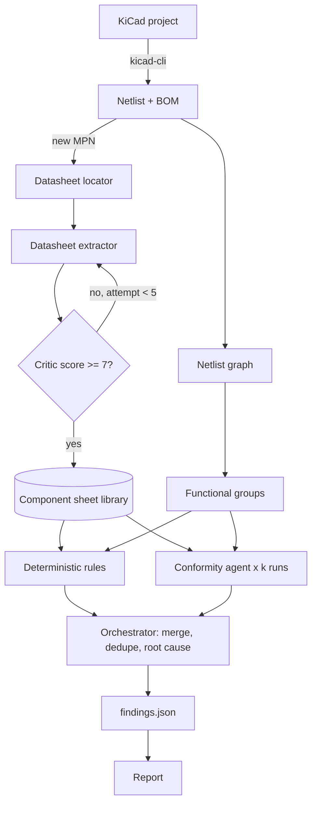

# Architecture

## Principles

1. **Python computes, the LLM judges.** Anything that can be checked mechanically
   (pin connections, derating, equations, absolute maximum ratings) is done in Python.
   Agents handle what needs interpretation: datasheet notes, edge cases, intent.
2. **No proof, no finding.** Every finding cites a datasheet page, a net, or a
   calculation. Findings without evidence are dropped by the orchestrator.
3. **Separate tool, not a KiCad plugin.** The pipeline reads KiCad files through
   `kicad-cli` and the `.kicad_sch` S-expressions. It runs from the terminal.
4. **Reuse before rebuilding.** kicad-happy, pcbsight, ngspice and LTspice are
   integrated rather than reimplemented.

## Flow

## The agents

| Agent | Role | Input | Output |
|---|---|---|---|
| Orchestrator | Plans the review, merges results. Does no analysis itself. | Spec, functional groups, all findings | `findings.json` |
| Datasheet locator | Finds the useful pages from the table of contents. | PDF | Page list per section |
| Datasheet extractor | Fills the component sheet, every value with its page. | Selected pages | Component sheet |
| Datasheet critic | Scores the sheet out of 10, triggers retries. | Sheet + PDF | Score + gaps |
| Conformity | Compares a functional group to its sheets. | Group subgraph + sheets + rule results | Findings |
| Footprint (planned) | Compares `.kicad_mod` to the datasheet land pattern. | Footprints + sheets | Findings |
| SPICE (planned) | Simulates simple subcircuits with ngspice / LTspice. | Subcircuit | Findings |
| Layout (planned) | Uses pcbsight measurements and per-layer renders. | `.kicad_pcb` | Findings |
| Theorist (planned) | Answers design questions from a reference library. | Question + documents | Explanation |

## Datasheet pipeline

1. **Resolve.** MPN to PDF, manufacturer source first. Record revision and date.
   Cache key is `MPN@revision`, so a newer revision can be detected.
2. **Locate.** Read the table of contents, select only: pinout, absolute maximum
   ratings, recommended operating conditions, electrical characteristics, application
   circuit, layout guidelines.
3. **Extract.** Fill the sheet (`schemas/component_sheet.schema.json`).
4. **Critique.** Score out of 10 on completeness, pin coverage and application info.
   Retry with another approach below the threshold, up to 5 attempts.
5. **Validate.** Human validation the first time for power and mains parts.

## Conformity check

Input: one functional group (an active part plus its neighbors up to 2 hops), the
component sheets of every part in it, and the deterministic rule results.

Deterministic part (`src/pcb_pipeline/rules`):
- pin by pin: required connections, no floating inputs, NC really not connected
- required external components present and in range
- capacitor voltage derating (`rules/checklist.yaml`)
- equations: feedback divider gives the intended output voltage
- rails versus absolute maximum ratings

Agent part (`agents/conformity.md`): datasheet notes, application constraints,
mismatch between schematic and the intent stated in the spec.

## Consensus on critical blocks

LLM reviews are not deterministic. For power and mains groups, the conformity agent
runs k = 3 times in parallel. Findings seen in at least 2 runs keep high confidence;
the others are re-examined by the orchestrator before being kept or dropped.

## Findings format

See `schemas/findings.schema.json`. Each finding has: id, severity, block, refs,
description, evidence (page, net, calculation), confidence, root cause, source stage.
