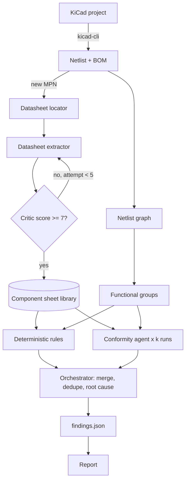

# PCB_Pipeline: handoff for Claude Code

This file holds all the context from the design discussions and the full code of the
`ET-FR/PCB_Pipeline` repo.

## Instructions for Claude Code

1. Recreate every file listed in the "Code" section at its exact path, at the repo root.
   The content of each file sits between the 5-backtick code fences that follow its path.
2. Install and test: `pip install -e ".[dev]"` then `pytest -q` (19 tests must pass).
3. Check the trapped project:
   `pcb-pipeline check --netlist tests/fixtures/buck_trapped.xml --library examples/component_sheets --rail /VIN=12 --rail /+5V=5`
   must output 4 findings: CAP-001 (critical), PIN-001 (critical), EQ-001 (major), SYM-001 (major).
4. Commit with the message "Pipeline definition, schemas, agent prompts and deterministic core" and push to `main`.
5. Add this file itself as `docs/handoff.md` to keep a record of the decisions.

## Context and design decisions

### Goal
An AI agent environment for Thomas's hardware projects: read a KiCad project, check the
datasheets, make proposals, then later check the mechanics (Onshape), the firmware and run
a test harness. We start with the electronics and the datasheets.

### Key choices
- **Tool separate from KiCad**, driven from the terminal with Claude Code. No Python GUI
  (Tkinter, Qt): the time goes into review quality, not into the UI.
- **KiCad is read through `kicad-cli`** (`kicad-cli sch export netlist --format kicadxml`), which resolves
  the hierarchy, global labels and net names. Symbol properties come from the netlist
  fields (or from the `.kicad_sch` S-expressions if needed).
- **Mandatory symbol fields**: `MPN` everywhere, `Voltage` on capacitors,
  `Tolerance` useful for dividers. Without them, most automatic checks are impossible.
- **"Python computes, the LLM judges"**: everything that can be checked mechanically (pins, derating,
  equations, absolute maximum values) is deterministic Python. The agents handle datasheet
  notes, edge cases and consistency with the spec.
- **"No evidence, no finding"**: every finding cites a datasheet page, a net or a
  calculation. This is enforced by the JSON Schema (evidence minItems 1, page required on every value).
- **The KiCad MCP server** stays complementary for exploratory reviews, but systematic
  checks live in the deterministic tool so they are reproducible.

### When to run the system
- **Fast layer (deterministic)**: on every commit (pre-commit hook) or on save. A few
  seconds, no tokens.
- **Agent layer**: on demand (`/review`), on pull request (report as a comment), and before
  sending to fabrication (mandatory full review, the "design gate"). Never continuously or every
  5 minutes: a schematic being drawn is inconsistent and it would cost a lot for nothing.
- **Datasheet agent**: when a new MPN appears in the BOM, once per component, then cached.
- **Incremental review**: the netlist is compared with the previous one and agents are rerun only on
  the functional groups that changed.

### Interface
- Terminal with Claude Code as the main interface.
- Static report (Markdown now, HTML later): findings sorted by severity, filterable by
  block, evidence linking to the datasheet page.
- Later, an optional KiCad extension that reads the JSON and highlights the affected components.

### The agent team
- **Review lead (orchestrator)**: plans, splits into functional groups, launches the agents,
  merges, deduplicates, groups by root cause, sorts by severity. Analyzes nothing itself.
- **Datasheet agent** with three sub-agents: locator, extractor, critic.
- **Conformity agent**: compares a functional group with its sheets.
- **Planned**: Footprint agent (`.kicad_mod` against land pattern), SPICE agent (ngspice then LTspice),
  Layout agent (pcbsight measurements, per-layer renders), Theorist agent (electronics book base).

### Datasheet pipeline
1. Resolution: MPN to PDF, manufacturer source first, revision and date recorded. Cache key
   `MPN@revision`, to detect a newer revision (real case: a supplied copy predated
   a fix published in revision G).
2. Locating: the table of contents is used to select only pinout, absolute max, recommended
   conditions, electrical characteristics, application circuit, layout notes.
3. Extraction: JSON sheet, every value with its page, never a guessed value.
4. Critique: score out of 10 (completeness 4, pin coverage 3, application info 3), at least
   3 values checked in the PDF, one error caps the score at 4. Retry below 7, 5 attempts maximum.
5. Human validation the first time for power and mains components.

### Conformity agent
Input: the group (active component plus neighbors within 2 hops, stopping at other active components), the
sheets, the results of the deterministic rules. Deterministic checks: pin by pin, required
external components, capacitor derating, equations (feedback divider), rails against absolute max.
The agent adds judgment: datasheet notes, wrong component type (dielectric, ESR),
sequencing, EN and power-good, boot strapping, consistency with the spec.

### Ideas taken from existing tools
Tools studied: DRCY (AllSpice, multi-agent, pin by pin analysis, runs in CI), Traceformer
(KiCad and Altium, every finding cites datasheet pages), pcbsight (`.kicad_pcb` review for
agents, Claude Code plugin), kicad-happy (MIT licensed Claude Code plugin, covers a good part
of the deterministic layer and datasheet extraction), Cady, Cadstrom. Flux, Quilter and CELUS
are more about generation.
Ideas adopted: automatic functional grouping, locating through the table of contents, critique with
retry, revision check, **multi-run consensus** (3 parallel runs on power and mains,
findings that appear in at least 2 runs are kept with confidence, the rest is re-examined), grouping
by root cause, two model tiers (powerful model for extraction and conformity, cheaper
model for locating and deduplication).
Tools to reuse rather than rewrite: kicad-happy, pcbsight, ngspice, LTspice.

### Roadmap (11 steps)
1. Foundations: repo structure, `pipeline.yaml`, `kicad-cli` import, pre-commit hook. **(done)**
2. Test existing tools: kicad-happy and pcbsight on a finished project; what they miss becomes
   requirements and traps for the "trapped project". **(recommended next step)**
3. Formats: JSON Schema for sheets and findings, aligned with kicad-happy. **(first draft done)**
4. Datasheet and Conformity agents, tested first on 5 to 10 components known by heart.
5. Critique, multi-run consensus, trapped project, benchmark against Traceformer.
6. Footprint agent.
7. SPICE agent.
8. Layout agent.
9. Theorist agent and document base.
10. HTML report, `/review` command, review on pull request.
11. KiCad highlighting extension (optional).

### Current state of the code
- Working deterministic core: netlist import, graph and functional groups, rule engine
  (SYM-001 missing MPN, PIN-001/002 pins, CAP-001 derating, ABS-001 absolute max, EQ-001 equations),
  schema-validated findings, Markdown report, CLI `pcb-pipeline check | validate-sheet | report`.
- Agent prompts written but not yet wired to an executable orchestrator.
- Rail voltages are not in the netlist: declare them in `rules/checklist.yaml`
  (`rails`) or with `--rail NET=V`.
- The `EXAMPLE-BUCK-01` sheet is a **fictional** component with illustrative values, for tests
  only.
- Paths to `schemas/` and `rules/` assume an editable install (`pip install -e`).

## Code

### `.claude/commands/review.md`

`````markdown
Run a design review of the KiCad project at: $ARGUMENTS

1. Run `pcb-pipeline check $ARGUMENTS --out out/` (import, graph, deterministic rules).
2. Read `agents/orchestrator.md` and follow it, using the outputs in `out/`.
3. Write `out/findings.json`, validate it, then run `pcb-pipeline report out/findings.json`.
4. Summarize the critical and major findings in the terminal, with their evidence.

`````

### `.github/workflows/review.yml`

`````yaml
name: checks

on:
  push:
  pull_request:

jobs:
  test:
    runs-on: ubuntu-latest
    steps:
      - uses: actions/checkout@v4
      - uses: actions/setup-python@v5
        with:
          python-version: "3.12"
      - run: pip install -e ".[dev]"
      - run: pytest -q
      - name: Validate component sheet library
        run: |
          shopt -s nullglob
          for f in library/component_sheets/*.json examples/component_sheets/*.json; do
            pcb-pipeline validate-sheet "$f"
          done

`````

### `.gitignore`

`````text
__pycache__/
*.pyc
*.egg-info/
.venv/
build/
dist/
.pytest_cache/
out/
reports/
*.kicad_prl
fp-info-cache

`````

### `.pre-commit-config.yaml`

`````yaml
# Deterministic layer on every commit, in the hardware project repo.
# Copy this into your KiCad project and adjust the path to the schematic.
repos:
  - repo: local
    hooks:
      - id: pcb-pipeline-check
        name: pcb-pipeline deterministic checks
        entry: pcb-pipeline check
        args: ["project.kicad_sch", "--fail-on", "critical"]
        language: system
        files: '\.kicad_sch$'
        pass_filenames: false

`````

### `CLAUDE.md`

`````markdown
# Instructions for Claude Code

This repository is a design review pipeline for KiCad projects. When working here:

- The Python core (`src/pcb_pipeline`) must stay deterministic. Anything that needs
  judgment belongs in an agent prompt under `agents/`, not in Python.
- Component sheets and findings must validate against `schemas/`. Run
  `pcb-pipeline validate-sheet` on any sheet you create or edit.
- Rule of evidence: a finding without `evidence` (datasheet page, net, or calculation)
  is invalid and must be dropped, never "softened".
- Never invent datasheet values. If a value cannot be found in the PDF, leave the field
  out and lower the sheet's critic score.
- Run `pytest` before committing.

## Running a review

Use `/review <path-to-project>` (see `.claude/commands/review.md`).

`````

### `README.md`

`````markdown
# PCB_Pipeline

Multi-agent design review pipeline for KiCad hardware projects.

The pipeline reads a KiCad project, builds a structured component sheet for every
part from its datasheet, then checks the schematic against those sheets. Deterministic
checks run in Python; AI agents (driven from Claude Code) handle judgment calls.
Every finding must cite its evidence: **no proof, no finding.**

## Status

Step 1 of the [roadmap](docs/roadmap.md): foundations, data formats, deterministic core.
Agents are defined (prompts in [`agents/`](agents/)) but not yet wired to an orchestrator.

## How it works

```
KiCad project ──kicad-cli──> netlist + BOM ──> netlist graph ──> functional groups
                                                     │
MPN list ──> Datasheet agent ──> component sheets ───┤
             (locate > extract > critique)           │
                                                     v
                         Deterministic rules + Conformity agent
                                                     │
                                                     v
                              findings.json ──> report (Markdown / HTML)
```

See [docs/architecture.md](docs/architecture.md) for the full design.

## Trapped project

`tests/fixtures/buck_trapped.xml` is a small buck converter with deliberate errors
(floating EN pin, 10 V capacitor on a 12 V rail, feedback divider giving 4.44 V
instead of 5 V, MCU without MPN). Every deterministic rule must catch its trap:

```bash
pcb-pipeline check --netlist tests/fixtures/buck_trapped.xml \
  --library examples/component_sheets --rail /VIN=12 --rail /+5V=5
```

New traps are added here each time a real review misses something.

## Quick start

```bash
pip install -e ".[dev]"

# Deterministic layer only (fast, free, runs on every commit)
pcb-pipeline check path/to/project.kicad_sch

# Same thing from an already exported KiCad XML netlist
pcb-pipeline check --netlist path/to/netlist.xml

# Validate a component sheet against the schema
pcb-pipeline validate-sheet library/component_sheets/MY-MPN.json
```

The full agent review is launched from Claude Code with the `/review` command
(see [`.claude/commands/review.md`](.claude/commands/review.md)).

## Requirements on the KiCad side

Every symbol should carry these fields, otherwise most automatic checks are impossible:

| Field | Example | Used by |
|---|---|---|
| `MPN` | `GRM188R61E106MA73` | Datasheet agent, cache key |
| `Voltage` | `25V` | Capacitor derating |
| `Tolerance` | `1%` | Divider and feedback calculations |

## Repository layout

| Path | Content |
|---|---|
| `pipeline.yaml` | Pipeline definition: stages, triggers, thresholds |
| `schemas/` | JSON Schemas for component sheets and findings |
| `agents/` | Agent prompts (orchestrator, datasheet, critic, conformity) |
| `rules/` | Deterministic rule configuration (derating, etc.) |
| `library/component_sheets/` | Shared, cached component sheets (one per MPN + revision) |
| `src/pcb_pipeline/` | Python core: KiCad import, netlist graph, rules engine, findings |
| `tests/` | Unit tests and fixtures |

## Reused tools

The pipeline deliberately builds on existing free tools rather than replacing them:
kicad-happy (deterministic layer and datasheet extraction), pcbsight (layout
measurements), ngspice and LTspice (simulation).

`````

### `agents/conformity.md`

`````markdown
# Conformity agent

Goal: compare one functional group of the schematic to the component sheets of its parts.

## Inputs
- the group subgraph: parts, values, symbol fields, and every net with its nodes
- the component sheets of the parts in the group
- the deterministic rule findings for this group (do not repeat them, build on them)
- the project spec, if any

## What to check
The deterministic rules already cover floating pins, derating, abs max and equations.
Focus on what needs judgment:
- datasheet notes and application constraints not captured as structured fields
- external components present but of the wrong kind (e.g. dielectric, ESR, rating)
- sequencing, enable logic, power-good usage, reset and boot strapping
- consistency with the intent stated in the spec (target voltages, currents, interfaces)

## Rules
- **No proof, no finding.** Each finding cites at least one datasheet page or net.
- Do not report style preferences. Only report what can cause a malfunction, a
  reliability issue, or a violation of the datasheet.
- If unsure, report it with `confidence: low` rather than dropping it silently.

## Output
A list of findings matching the `findings` items of `schemas/findings.schema.json`,
with `source: "conformity"` and ids `CONF-001`, `CONF-002`, etc.

`````

### `agents/datasheet_critic.md`

`````markdown
# Datasheet critic

Goal: score an extracted component sheet and decide whether to retry.

## Scoring (out of 10)
- **Completeness (4 pts)**: absolute maximum, recommended operating, key electrical
  characteristics present.
- **Pin coverage (3 pts)**: every package pin present with a type and a requirement.
- **Application info (3 pts)**: external components, equations, layout notes.

Spot check at least 3 values against the PDF pages. A wrong value caps the score at 4.

## Output
```json
{ "score": 8, "errors": [], "gaps": ["no thermal data"], "retry": false,
  "retry_hint": "" }
```
Retry if `score < 7`, with a hint (other pages, other source, missing section).
Stop after 5 attempts and flag the sheet for human validation.

`````

### `agents/datasheet_extractor.md`

`````markdown
# Datasheet extractor

Goal: fill one component sheet that validates against `schemas/component_sheet.schema.json`.

## Rules
- Every value carries the page it was read from. No page, no value.
- Never infer or guess a value. If the datasheet does not give it, leave it out and
  add a line to `extraction.gaps`.
- Pin names must match the datasheet exactly, so the conformity agent can map them
  to the symbol pins.
- For each pin, set `requirement` from the datasheet text (for example an EN pin that
  "must not be left floating" is `no_float`).
- Equations must be Python-evaluable. Constants (VREF, etc.) go in `constants`,
  and each variable maps to the pins the corresponding part sits between.
- Set `criticality`: `power` for regulators and power switches, `mains` for anything
  connected to mains voltage.

## Output
The component sheet, saved as `library/component_sheets/<MPN>@<revision>.json`,
then validated with `pcb-pipeline validate-sheet`.

`````

### `agents/datasheet_locator.md`

`````markdown
# Datasheet locator

Goal: reduce cost by selecting only the useful pages of a datasheet.

## Input
A datasheet PDF and the MPN.

## Steps
1. Confirm the PDF matches the MPN (exact part, package, suffix). Record revision and date.
2. Check whether a newer revision exists from the manufacturer. If yes, use it and say so.
3. From the table of contents (or page headers if there is none), return the pages for:
   pinout, absolute maximum ratings, recommended operating conditions, electrical
   characteristics, application circuit and component selection, layout guidelines.

## Output
```json
{ "mpn": "...", "revision": "...", "date": "...", "source_url": "...",
  "sections": { "pinout": [3, 4], "absolute_maximum": [5], "...": [] } }
```

`````

### `agents/orchestrator.md`

`````markdown
# Orchestrator (review lead)

You lead a design review of a KiCad project. You do not analyze circuits yourself.

## Inputs
- `out/netlist.json` and `out/groups.json` produced by `pcb-pipeline graph`
- `out/rules_findings.json` produced by `pcb-pipeline check`
- the component sheet library (`library/component_sheets/`)
- the project spec, if one exists (`spec.md` at the project root)

## Steps
1. List MPNs without a component sheet. For each, run the datasheet pipeline
   (`datasheet_locator`, then `datasheet_extractor`, then `datasheet_critic`).
2. Review the proposed functional groups. Merge or split them if needed so that each
   group is a regulator with its feedback and capacitors, an MCU with its clock and
   decoupling, a transceiver with its terminations, etc. Tag each group with a
   criticality (`standard`, `power`, `mains`).
3. Run the `conformity` agent once per group, or 3 times in parallel for `power`
   and `mains` groups (see `pipeline.yaml`).
4. Merge all findings:
   - drop any finding without evidence
   - deduplicate findings that describe the same issue
   - for consensus groups, keep findings seen in at least 2 runs with their confidence,
     re-examine the others and keep them only if the evidence holds, with `low` confidence
   - group findings by `root_cause`
5. Write `out/findings.json` and validate it against `schemas/findings.schema.json`.

`````

### `docs/architecture.md`

`````markdown
# Architecture

## Principles

1. **Python computes, the LLM judges.** Anything that can be checked mechanically
   (pin connections, derating, equations, absolute maximum ratings) is done in Python.
   Agents handle what needs interpretation: datasheet notes, edge cases, intent.
2. **No proof, no finding.** Every finding cites a datasheet page, a net, or a
   calculation. Findings without evidence are dropped by the orchestrator.
3. **Separate tool, not a KiCad plugin.** The pipeline reads KiCad files through
   `kicad-cli` and the `.kicad_sch` S-expressions. It runs from the terminal.
4. **Reuse before rebuilding.** kicad-happy, pcbsight, ngspice and LTspice are
   integrated rather than reimplemented.

## Flow



## The agents

| Agent | Role | Input | Output |
|---|---|---|---|
| Orchestrator | Plans the review, merges results. Does no analysis itself. | Spec, functional groups, all findings | `findings.json` |
| Datasheet locator | Finds the useful pages from the table of contents. | PDF | Page list per section |
| Datasheet extractor | Fills the component sheet, every value with its page. | Selected pages | Component sheet |
| Datasheet critic | Scores the sheet out of 10, triggers retries. | Sheet + PDF | Score + gaps |
| Conformity | Compares a functional group to its sheets. | Group subgraph + sheets + rule results | Findings |
| Footprint (planned) | Compares `.kicad_mod` to the datasheet land pattern. | Footprints + sheets | Findings |
| SPICE (planned) | Simulates simple subcircuits with ngspice / LTspice. | Subcircuit | Findings |
| Layout (planned) | Uses pcbsight measurements and per-layer renders. | `.kicad_pcb` | Findings |
| Theorist (planned) | Answers design questions from a reference library. | Question + documents | Explanation |

## Datasheet pipeline

1. **Resolve.** MPN to PDF, manufacturer source first. Record revision and date.
   Cache key is `MPN@revision`, so a newer revision can be detected.
2. **Locate.** Read the table of contents, select only: pinout, absolute maximum
   ratings, recommended operating conditions, electrical characteristics, application
   circuit, layout guidelines.
3. **Extract.** Fill the sheet (`schemas/component_sheet.schema.json`).
4. **Critique.** Score out of 10 on completeness, pin coverage and application info.
   Retry with another approach below the threshold, up to 5 attempts.
5. **Validate.** Human validation the first time for power and mains parts.

## Conformity check

Input: one functional group (an active part plus its neighbors up to 2 hops), the
component sheets of every part in it, and the deterministic rule results.

Deterministic part (`src/pcb_pipeline/rules`):
- pin by pin: required connections, no floating inputs, NC really not connected
- required external components present and in range
- capacitor voltage derating (`rules/checklist.yaml`)
- equations: feedback divider gives the intended output voltage
- rails versus absolute maximum ratings

Agent part (`agents/conformity.md`): datasheet notes, application constraints,
mismatch between schematic and the intent stated in the spec.

## Consensus on critical blocks

LLM reviews are not deterministic. For power and mains groups, the conformity agent
runs k = 3 times in parallel. Findings seen in at least 2 runs keep high confidence;
the others are re-examined by the orchestrator before being kept or dropped.

## Findings format

See `schemas/findings.schema.json`. Each finding has: id, severity, block, refs,
description, evidence (page, net, calculation), confidence, root cause, source stage.

`````

### `docs/roadmap.md`

`````markdown
# Roadmap

- [ ] **1. Foundations**: repo structure, `pipeline.yaml`, `kicad-cli` import, pre-commit hook.
- [ ] **2. Test existing tools**: run kicad-happy and pcbsight on a finished project, note what they find and what they miss. Use the misses as seed requirements and as the "trapped project" test suite.
- [ ] **3. Formats**: JSON Schemas for component sheets and `findings.json`, aligned with kicad-happy outputs; MPN and Voltage fields in all symbols.
- [ ] **4. Datasheet and Conformity agents** on top of kicad-happy extraction, plus the rule checklist. First test on 5 to 10 parts known by heart.
- [ ] **5. Critic, multi-run consensus and trapped project**, benchmark against Traceformer.
- [ ] **6. Footprint agent**: parse `.kicad_mod`, compare to land pattern.
- [ ] **7. SPICE agent**: simple subcircuits with ngspice, then LTspice for converters.
- [ ] **8. Layout agent** with pcbsight measurements and per-layer renders.
- [ ] **9. Theorist agent** and document base.
- [ ] **10. HTML report, `/review` command, pull request review.**
- [ ] **11. KiCad highlight plugin** (optional).

`````

### `examples/component_sheets/EXAMPLE-BUCK-01@A.json`

`````json
{
  "schema_version": 1,
  "mpn": "EXAMPLE-BUCK-01",
  "manufacturer": "Example (fictional part, illustrative values only)",
  "category": "regulator",
  "criticality": "power",
  "datasheet": { "revision": "A", "date": "2026-01", "source_url": "https://example.com/EXAMPLE-BUCK-01.pdf" },
  "absolute_maximum": [
    { "param": "VIN", "max": 18, "unit": "V", "page": 3 },
    { "param": "EN", "max": 6, "unit": "V", "page": 3 },
    { "param": "FB", "max": 3.6, "unit": "V", "page": 3 }
  ],
  "recommended_operating": [
    { "param": "VIN", "min": 4.5, "max": 16, "unit": "V", "page": 3 },
    { "param": "IOUT", "max": 2, "unit": "A", "page": 3 }
  ],
  "pins": [
    { "number": "1", "name": "VIN", "type": "power_in", "requirement": "must_connect", "page": 2 },
    { "number": "2", "name": "EN", "type": "input", "requirement": "no_float", "notes": "pull up to VIN or drive", "page": 2 },
    { "number": "3", "name": "GND", "type": "ground", "requirement": "tie_to_ground", "page": 2 },
    { "number": "4", "name": "SW", "type": "power_out", "requirement": "must_connect", "page": 2 },
    { "number": "5", "name": "FB", "type": "analog", "requirement": "must_connect", "page": 2 },
    { "number": "6", "name": "BOOT", "type": "passive", "requirement": "must_connect", "notes": "100 nF to SW", "page": 2 }
  ],
  "external_components": [
    { "role": "input capacitor", "kind": "capacitor", "between_pins": ["VIN", "GND"],
      "constraints": { "min_value": 10e-6, "unit": "F", "dielectric": ["X5R", "X7R"], "max_distance_mm": 3 }, "page": 10 },
    { "role": "bootstrap capacitor", "kind": "capacitor", "between_pins": ["BOOT", "SW"],
      "constraints": { "min_value": 100e-9, "unit": "F" }, "page": 10 }
  ],
  "equations": [
    { "name": "output voltage", "expression": "VREF * (1 + R_TOP / R_BOTTOM)", "unit": "V",
      "constants": { "VREF": 0.8 },
      "variables": { "R_TOP": ["@TARGET", "FB"], "R_BOTTOM": ["FB", "@GND"] }, "page": 11 }
  ],
  "layout_notes": [
    { "text": "Place input capacitor as close as possible to VIN and GND pins.", "page": 14 }
  ],
  "extraction": { "critic_score": 9, "attempts": 1, "gaps": [], "human_validated": true, "pages_used": [2, 3, 10, 11, 14] }
}

`````

### `pipeline.yaml`

`````yaml
# PCB_Pipeline definition.
# The orchestrator reads this file to decide which stages run, when, and how.

version: 1

inputs:
  kicad_cli: kicad-cli            # path to kicad-cli
  required_symbol_fields: [MPN]   # missing fields are reported as findings
  recommended_symbol_fields: [Voltage, Tolerance]

library:
  component_sheets: library/component_sheets
  cache_key: "{mpn}@{datasheet_revision}"

triggers:
  deterministic:                  # fast layer, seconds, no tokens
    - pre_commit
    - on_save                     # optional watcher on *.kicad_sch
  agents:                         # slow layer, minutes, uses tokens
    - on_demand                   # /review in Claude Code
    - pull_request                # report posted as PR comment
    - pre_fabrication             # full review, mandatory design gate
  datasheet:
    - new_mpn_in_bom              # build a sheet once per MPN, then cache
  incremental: true               # only re-review functional groups whose netlist changed

stages:
  - id: import
    kind: deterministic
    description: Export netlist and BOM with kicad-cli, parse symbol fields.
    outputs: [netlist.xml, bom.csv]

  - id: graph
    kind: deterministic
    description: Build the netlist graph and propose functional groups.
    params:
      neighborhood_depth: 2       # hops around an active part
      ignore_nets: [GND, "/GND"]  # nets too connected to be useful for grouping

  - id: datasheet
    kind: agent
    agents: [datasheet_locator, datasheet_extractor, datasheet_critic]
    description: Build or refresh one component sheet per MPN.
    params:
      critic_min_score: 7
      max_attempts: 5
      human_validation_for: [power, mains]

  - id: rules
    kind: deterministic
    description: Run the rule engine (rules/checklist.yaml) against sheets and netlist.

  - id: conformity
    kind: agent
    agents: [conformity]
    description: Compare each functional group to its component sheets.
    params:
      consensus_runs:
        default: 1
        power: 3
        mains: 3
      consensus_min_agreement: 2  # findings seen in >= 2 of 3 runs keep high confidence

  - id: merge
    kind: agent
    agents: [orchestrator]
    description: Deduplicate, group by root cause, rank by severity.
    outputs: [findings.json]

  - id: report
    kind: deterministic
    description: Render findings.json to Markdown (now) and HTML (later).
    outputs: [report.md]

models:
  extraction: high_capability     # datasheet extraction and conformity
  triage: low_cost                # page location, deduplication

`````

### `pyproject.toml`

`````toml
[build-system]
requires = ["setuptools>=68"]
build-backend = "setuptools.build_meta"

[project]
name = "pcb-pipeline"
version = "0.1.0"
description = "Multi-agent design review pipeline for KiCad projects"
requires-python = ">=3.10"
dependencies = ["jsonschema>=4.20", "pyyaml>=6.0", "networkx>=3.0"]

[project.optional-dependencies]
dev = ["pytest>=8.0"]

[project.scripts]
pcb-pipeline = "pcb_pipeline.cli:main"

[tool.setuptools.packages.find]
where = ["src"]

[tool.pytest.ini_options]
testpaths = ["tests"]
pythonpath = ["src"]

`````

### `rules/checklist.yaml`

`````yaml
# Deterministic rules. Each rule has an id used in findings evidence.
version: 1

rules:
  - id: SYM-001
    description: Every non-passive symbol has an MPN field.
    severity: major

  - id: PIN-001
    description: Pins marked no_float or must_connect are connected to a net with at least one other node.
    severity: critical

  - id: PIN-002
    description: Pins marked must_not_connect have no other node on their net.
    severity: major

  - id: CAP-001
    description: Ceramic capacitor voltage rating versus applied rail voltage.
    severity: major
    params:
      min_ratio: 1.5        # rated voltage >= 1.5 x applied voltage
      recommended_ratio: 2.0

  - id: ABS-001
    description: Rail voltage stays below the absolute maximum of every pin connected to it.
    severity: critical

  - id: EQ-001
    description: Datasheet equations (e.g. feedback divider) give the target value within tolerance.
    severity: major
    params:
      tolerance_percent: 2

# Rail voltages are not in the netlist. Declare them here or in the project spec.
rails: {}
#  "/+5V": 5.0
#  "/VIN": 12.0

`````

### `schemas/component_sheet.schema.json`

`````json
{
  "$schema": "https://json-schema.org/draft/2020-12/schema",
  "$id": "https://github.com/ET-FR/PCB_Pipeline/schemas/component_sheet.schema.json",
  "title": "Component sheet",
  "description": "Structured extraction of one datasheet. Every value carries the page it comes from.",
  "type": "object",
  "required": [
    "schema_version",
    "mpn",
    "manufacturer",
    "datasheet",
    "category",
    "pins",
    "extraction"
  ],
  "additionalProperties": false,
  "$defs": {
    "page": {
      "type": "integer",
      "minimum": 1
    },
    "limit": {
      "type": "object",
      "required": [
        "param",
        "unit",
        "page"
      ],
      "additionalProperties": false,
      "properties": {
        "param": {
          "type": "string",
          "description": "Parameter name, ideally a pin or rail name (VIN, VEN, IOUT)."
        },
        "min": {
          "type": "number"
        },
        "typ": {
          "type": "number"
        },
        "max": {
          "type": "number"
        },
        "unit": {
          "type": "string"
        },
        "conditions": {
          "type": "string"
        },
        "page": {
          "$ref": "#/$defs/page"
        }
      },
      "anyOf": [
        {
          "required": [
            "min"
          ]
        },
        {
          "required": [
            "typ"
          ]
        },
        {
          "required": [
            "max"
          ]
        }
      ]
    }
  },
  "properties": {
    "schema_version": {
      "const": 1
    },
    "mpn": {
      "type": "string",
      "minLength": 1
    },
    "manufacturer": {
      "type": "string"
    },
    "category": {
      "type": "string",
      "enum": [
        "regulator",
        "mcu",
        "interface",
        "power_switch",
        "sensor",
        "passive",
        "connector",
        "protection",
        "other"
      ]
    },
    "criticality": {
      "type": "string",
      "enum": [
        "standard",
        "power",
        "mains"
      ],
      "default": "standard"
    },
    "datasheet": {
      "type": "object",
      "required": [
        "revision",
        "source_url"
      ],
      "additionalProperties": false,
      "properties": {
        "revision": {
          "type": "string"
        },
        "date": {
          "type": "string"
        },
        "source_url": {
          "type": "string"
        },
        "sha256": {
          "type": "string"
        }
      }
    },
    "absolute_maximum": {
      "type": "array",
      "items": {
        "$ref": "#/$defs/limit"
      }
    },
    "recommended_operating": {
      "type": "array",
      "items": {
        "$ref": "#/$defs/limit"
      }
    },
    "pins": {
      "type": "array",
      "minItems": 1,
      "items": {
        "type": "object",
        "required": [
          "number",
          "name",
          "type",
          "page"
        ],
        "additionalProperties": false,
        "properties": {
          "number": {
            "type": "string"
          },
          "name": {
            "type": "string"
          },
          "type": {
            "type": "string",
            "enum": [
              "power_in",
              "power_out",
              "ground",
              "input",
              "output",
              "bidirectional",
              "analog",
              "open_drain",
              "nc",
              "passive"
            ]
          },
          "requirement": {
            "type": "string",
            "enum": [
              "none",
              "must_connect",
              "no_float",
              "must_not_connect",
              "pull_up",
              "pull_down",
              "tie_to_ground"
            ],
            "default": "none"
          },
          "notes": {
            "type": "string"
          },
          "page": {
            "$ref": "#/$defs/page"
          }
        }
      }
    },
    "external_components": {
      "type": "array",
      "items": {
        "type": "object",
        "required": [
          "role",
          "between_pins",
          "page"
        ],
        "additionalProperties": false,
        "properties": {
          "role": {
            "type": "string",
            "description": "e.g. input capacitor, bootstrap capacitor, feedback divider"
          },
          "kind": {
            "type": "string",
            "enum": [
              "capacitor",
              "resistor",
              "inductor",
              "diode",
              "other"
            ]
          },
          "between_pins": {
            "type": "array",
            "items": {
              "type": "string"
            },
            "minItems": 1
          },
          "constraints": {
            "type": "object",
            "additionalProperties": false,
            "properties": {
              "min_value": {
                "type": "number"
              },
              "max_value": {
                "type": "number"
              },
              "unit": {
                "type": "string"
              },
              "dielectric": {
                "type": "array",
                "items": {
                  "type": "string"
                }
              },
              "max_distance_mm": {
                "type": "number"
              }
            }
          },
          "page": {
            "$ref": "#/$defs/page"
          }
        }
      }
    },
    "equations": {
      "type": "array",
      "items": {
        "type": "object",
        "required": [
          "name",
          "expression",
          "page"
        ],
        "additionalProperties": false,
        "properties": {
          "name": {
            "type": "string"
          },
          "expression": {
            "type": "string",
            "description": "Python-evaluable expression, e.g. VREF * (1 + R_TOP / R_BOTTOM)"
          },
          "constants": {
            "type": "object",
            "additionalProperties": {
              "type": "number"
            }
          },
          "variables": {
            "type": "object",
            "description": "Maps each variable (a part value) to the two endpoints it sits between. An endpoint is a pin name of this part, '@GND' for any ground net, or '@TARGET' for the regulated net whose rail voltage the equation result is compared to.",
            "additionalProperties": {
              "type": "array",
              "items": {
                "type": "string"
              },
              "minItems": 2,
              "maxItems": 2
            }
          },
          "page": {
            "$ref": "#/$defs/page"
          },
          "unit": {
            "type": "string"
          }
        }
      }
    },
    "layout_notes": {
      "type": "array",
      "items": {
        "type": "object",
        "required": [
          "text",
          "page"
        ],
        "additionalProperties": false,
        "properties": {
          "text": {
            "type": "string"
          },
          "page": {
            "$ref": "#/$defs/page"
          }
        }
      }
    },
    "extraction": {
      "type": "object",
      "required": [
        "critic_score",
        "attempts"
      ],
      "additionalProperties": false,
      "properties": {
        "critic_score": {
          "type": "number",
          "minimum": 0,
          "maximum": 10
        },
        "attempts": {
          "type": "integer",
          "minimum": 1
        },
        "gaps": {
          "type": "array",
          "items": {
            "type": "string"
          }
        },
        "human_validated": {
          "type": "boolean",
          "default": false
        },
        "pages_used": {
          "type": "array",
          "items": {
            "$ref": "#/$defs/page"
          }
        }
      }
    }
  }
}

`````

### `schemas/findings.schema.json`

`````json
{
  "$schema": "https://json-schema.org/draft/2020-12/schema",
  "$id": "https://github.com/ET-FR/PCB_Pipeline/schemas/findings.schema.json",
  "title": "Review findings",
  "type": "object",
  "required": ["schema_version", "project", "generated_at", "findings"],
  "additionalProperties": false,
  "properties": {
    "schema_version": { "const": 1 },
    "project": { "type": "string" },
    "generated_at": { "type": "string" },
    "netlist_hash": { "type": "string" },
    "findings": {
      "type": "array",
      "items": {
        "type": "object",
        "required": ["id", "severity", "title", "refs", "evidence", "confidence", "source"],
        "additionalProperties": false,
        "properties": {
          "id": { "type": "string", "pattern": "^[A-Z]+-[0-9]{3,}$" },
          "severity": { "type": "string", "enum": ["critical", "major", "minor", "info"] },
          "title": { "type": "string" },
          "description": { "type": "string" },
          "block": { "type": "string", "description": "Functional group, e.g. power/buck_5v" },
          "refs": { "type": "array", "items": { "type": "string" }, "minItems": 1 },
          "nets": { "type": "array", "items": { "type": "string" } },
          "evidence": {
            "type": "array",
            "minItems": 1,
            "description": "No proof, no finding.",
            "items": {
              "type": "object",
              "required": ["kind"],
              "additionalProperties": false,
              "properties": {
                "kind": { "type": "string", "enum": ["datasheet", "netlist", "calculation", "rule"] },
                "mpn": { "type": "string" },
                "page": { "type": "integer", "minimum": 1 },
                "summary": { "type": "string" },
                "net": { "type": "string" },
                "calculation": { "type": "string" },
                "rule_id": { "type": "string" }
              }
            }
          },
          "suggestion": { "type": "string" },
          "confidence": { "type": "string", "enum": ["high", "medium", "low"] },
          "consensus": {
            "type": "object",
            "additionalProperties": false,
            "properties": { "runs": { "type": "integer" }, "seen_in": { "type": "integer" } }
          },
          "root_cause": { "type": "string", "description": "Findings sharing a root cause are grouped in the report." },
          "source": { "type": "string", "enum": ["import", "rules", "conformity", "footprint", "spice", "layout"] }
        }
      }
    }
  }
}

`````

### `src/pcb_pipeline/__init__.py`

`````python
"""Multi-agent design review pipeline for KiCad projects."""

__version__ = "0.1.0"

`````

### `src/pcb_pipeline/cli.py`

`````python
"""Command line interface: pcb-pipeline check | validate-sheet | report."""

from __future__ import annotations

import argparse
import json
import sys
from dataclasses import asdict
from pathlib import Path

import yaml

from .datasheet.library import SheetLibrary
from .findings import SEVERITY_ORDER, Findings
from .kicad_import import export_netlist, parse_netlist_xml
from .netlist import functional_groups
from .report import render_markdown
from .rules.engine import load_rules, RuleEngine
from .schemas import validate

REPO = Path(__file__).resolve().parents[2]


def _pipeline_config() -> dict:
    p = REPO / "pipeline.yaml"
    return yaml.safe_load(p.read_text()) if p.exists() else {}


def _parse_rails(items: list[str]) -> dict[str, float]:
    rails = {}
    for item in items or []:
        net, _, volts = item.partition("=")
        rails[net] = float(volts)
    return rails


def cmd_check(args) -> int:
    cfg = _pipeline_config()
    out = Path(args.out)
    out.mkdir(parents=True, exist_ok=True)

    if args.netlist:
        netlist_path = Path(args.netlist)
        project = netlist_path.stem
    elif args.schematic:
        sch = Path(args.schematic)
        netlist_path = export_netlist(sch, out, cfg.get("inputs", {}).get("kicad_cli", "kicad-cli"))
        project = sch.stem
    else:
        print("error: give a schematic or --netlist", file=sys.stderr)
        return 2

    netlist = parse_netlist_xml(netlist_path)
    graph_cfg = next((s.get("params", {}) for s in cfg.get("stages", []) if s.get("id") == "graph"), {})
    groups = functional_groups(netlist, graph_cfg.get("neighborhood_depth", 2), graph_cfg.get("ignore_nets"))

    lib_dirs = [Path(d) for d in (args.library or [REPO / "library" / "component_sheets"])]
    library = SheetLibrary(*lib_dirs)
    for path, errs in library.errors.items():
        print(f"warning: invalid sheet {path}: {errs[0]}", file=sys.stderr)

    findings = Findings(project)
    rules = load_rules(Path(args.rules) if args.rules else None)
    RuleEngine(netlist, library, findings, rules, _parse_rails(args.rail)).run()
    doc = findings.to_doc()

    mpns = [c.mpn for c in netlist.components.values() if c.mpn]
    (out / "netlist.json").write_text(json.dumps(
        {"components": {k: asdict(v) for k, v in netlist.components.items()},
         "nets": {k: [asdict(n) for n in v] for k, v in netlist.nets.items()}}, indent=2))
    (out / "groups.json").write_text(json.dumps(groups, indent=2))
    (out / "missing_sheets.json").write_text(json.dumps(library.missing(mpns), indent=2))
    (out / "rules_findings.json").write_text(json.dumps(doc, indent=2, ensure_ascii=False))
    (out / "rules_report.md").write_text(render_markdown(doc))

    counts = {s: sum(f["severity"] == s for f in doc["findings"]) for s in SEVERITY_ORDER}
    print(f"{project}: {len(netlist.components)} parts, {len(groups)} functional groups, "
          f"{len(library.missing(mpns))} MPN without sheet")
    print("findings: " + ", ".join(f"{k} {v}" for k, v in counts.items()))
    for f in doc["findings"]:
        print(f"  [{f['severity']}] {f['id']} {f['title']}")
    print(f"outputs in {out}/")

    if args.fail_on:
        limit = SEVERITY_ORDER[args.fail_on]
        if any(SEVERITY_ORDER[f["severity"]] <= limit for f in doc["findings"]):
            return 1
    return 0


def cmd_validate_sheet(args) -> int:
    status = 0
    for path in args.paths:
        errors = validate("component_sheet", json.loads(Path(path).read_text()))
        if errors:
            status = 1
            print(f"{path}: INVALID")
            for e in errors:
                print(f"  {e}")
        else:
            print(f"{path}: ok")
    return status


def cmd_report(args) -> int:
    doc = json.loads(Path(args.findings).read_text())
    errors = validate("findings", doc)
    if errors:
        print("findings.json invalid:\n  " + "\n  ".join(errors), file=sys.stderr)
        return 1
    md = render_markdown(doc)
    out = Path(args.output) if args.output else Path(args.findings).with_suffix(".md")
    out.write_text(md)
    print(f"report written to {out}")
    return 0


def main(argv: list[str] | None = None) -> int:
    p = argparse.ArgumentParser(prog="pcb-pipeline")
    sub = p.add_subparsers(dest="cmd", required=True)

    c = sub.add_parser("check", help="import, functional groups, deterministic rules")
    c.add_argument("schematic", nargs="?", help="root .kicad_sch file")
    c.add_argument("--netlist", help="use an exported KiCad XML netlist instead of kicad-cli")
    c.add_argument("--out", default="out")
    c.add_argument("--library", action="append", help="component sheet directory (repeatable)")
    c.add_argument("--rules", help="rules YAML (default rules/checklist.yaml)")
    c.add_argument("--rail", action="append", metavar="NET=VOLTS", help="declare a rail voltage")
    c.add_argument("--fail-on", choices=list(SEVERITY_ORDER), help="non-zero exit at this severity or worse")
    c.set_defaults(fn=cmd_check)

    v = sub.add_parser("validate-sheet", help="validate component sheets against the schema")
    v.add_argument("paths", nargs="+")
    v.set_defaults(fn=cmd_validate_sheet)

    r = sub.add_parser("report", help="render findings.json to Markdown")
    r.add_argument("findings")
    r.add_argument("-o", "--output")
    r.set_defaults(fn=cmd_report)

    args = p.parse_args(argv)
    try:
        return args.fn(args)
    except RuntimeError as exc:
        print(f"error: {exc}", file=sys.stderr)
        return 2


if __name__ == "__main__":
    sys.exit(main())

`````

### `src/pcb_pipeline/datasheet/__init__.py`

`````python

`````

### `src/pcb_pipeline/datasheet/library.py`

`````python
"""Component sheet library: one JSON file per MPN and datasheet revision."""

from __future__ import annotations

import json
from pathlib import Path

from ..schemas import validate


class SheetLibrary:
    def __init__(self, *dirs: Path):
        self.sheets: dict[str, dict] = {}
        self.errors: dict[str, list[str]] = {}
        for d in dirs:
            if not d.exists():
                continue
            for path in sorted(d.glob("*.json")):
                sheet = json.loads(path.read_text())
                errs = validate("component_sheet", sheet)
                if errs:
                    self.errors[str(path)] = errs
                    continue
                mpn = sheet["mpn"]
                # sorted glob: a later revision file overrides an earlier one
                self.sheets[mpn] = sheet

    def get(self, mpn: str | None) -> dict | None:
        return self.sheets.get(mpn) if mpn else None

    def missing(self, mpns: list[str]) -> list[str]:
        return sorted({m for m in mpns if m and m not in self.sheets})


def sheet_filename(sheet: dict) -> str:
    rev = sheet["datasheet"]["revision"].replace(" ", "").replace("/", "-")
    return f"{sheet['mpn']}@{rev}.json"

`````

### `src/pcb_pipeline/findings.py`

`````python
"""Findings collection and serialization."""

from __future__ import annotations

import datetime as dt
from collections import defaultdict

from .schemas import validate

SEVERITY_ORDER = {"critical": 0, "major": 1, "minor": 2, "info": 3}


class Findings:
    def __init__(self, project: str):
        self.project = project
        self.items: list[dict] = []
        self._counters: dict[str, int] = defaultdict(int)

    def add(self, prefix: str, severity: str, title: str, refs: list[str], evidence: list[dict],
            source: str, confidence: str = "high", **extra) -> dict:
        if not evidence:
            raise ValueError("No proof, no finding: evidence is required")
        self._counters[prefix] += 1
        item = {
            "id": f"{prefix}-{self._counters[prefix]:03d}",
            "severity": severity,
            "title": title,
            "refs": refs,
            "evidence": evidence,
            "confidence": confidence,
            "source": source,
        }
        item.update({k: v for k, v in extra.items() if v is not None})
        self.items.append(item)
        return item

    def to_doc(self) -> dict:
        doc = {
            "schema_version": 1,
            "project": self.project,
            "generated_at": dt.datetime.now(dt.timezone.utc).isoformat(timespec="seconds"),
            "findings": sorted(self.items, key=lambda f: (SEVERITY_ORDER[f["severity"]], f["id"])),
        }
        errors = validate("findings", doc)
        if errors:
            raise ValueError("findings.json does not match schema:\n" + "\n".join(errors))
        return doc

`````

### `src/pcb_pipeline/kicad_import.py`

`````python
"""Import a KiCad schematic through kicad-cli and parse the XML netlist."""

from __future__ import annotations

import subprocess
import xml.etree.ElementTree as ET
from dataclasses import dataclass, field
from pathlib import Path


@dataclass
class Node:
    ref: str
    pin: str
    pin_function: str = ""
    pin_type: str = ""


@dataclass
class Component:
    ref: str
    value: str = ""
    footprint: str = ""
    lib: str = ""
    part: str = ""
    fields: dict[str, str] = field(default_factory=dict)

    @property
    def mpn(self) -> str | None:
        for key in ("MPN", "mpn", "Manufacturer_Part_Number", "MFN"):
            if self.fields.get(key):
                return self.fields[key].strip()
        return None

    @property
    def prefix(self) -> str:
        return "".join(ch for ch in self.ref if ch.isalpha())

    @property
    def is_passive(self) -> bool:
        return self.prefix in {"R", "C", "L", "FB", "TP", "J", "H", "MH"}


@dataclass
class Netlist:
    components: dict[str, Component]
    nets: dict[str, list[Node]]

    def nets_of(self, ref: str) -> dict[str, str]:
        """Map pin number to net name for one component."""
        out = {}
        for net, nodes in self.nets.items():
            for n in nodes:
                if n.ref == ref:
                    out[n.pin] = net
        return out

    def node(self, ref: str, pin_name: str | None = None, pin_number: str | None = None):
        """Find the (net, node) of a component pin by function name, then by number."""
        candidates = []
        for net, nodes in self.nets.items():
            for n in nodes:
                if n.ref != ref:
                    continue
                if pin_name and _pin_name_matches(n.pin_function, pin_name):
                    return net, n
                if pin_number and n.pin == pin_number:
                    candidates.append((net, n))
        return candidates[0] if candidates else (None, None)


def _pin_name_matches(pin_function: str, name: str) -> bool:
    if not pin_function:
        return False
    # KiCad may suffix duplicated names: "GND_1", "GND_2"
    pf = pin_function.upper()
    nm = name.upper()
    return pf == nm or pf.split("_")[0] == nm


def export_netlist(schematic: Path, out_dir: Path, kicad_cli: str = "kicad-cli") -> Path:
    """Export the XML netlist with kicad-cli (KiCad resolves hierarchy and labels)."""
    out_dir.mkdir(parents=True, exist_ok=True)
    out = out_dir / "netlist.xml"
    cmd = [kicad_cli, "sch", "export", "netlist", "--format", "kicadxml",
           "--output", str(out), str(schematic)]
    try:
        subprocess.run(cmd, check=True, capture_output=True, text=True)
    except FileNotFoundError as exc:
        raise RuntimeError(
            f"'{kicad_cli}' not found. Install KiCad 8+ or pass --netlist with an exported netlist."
        ) from exc
    except subprocess.CalledProcessError as exc:
        raise RuntimeError(f"kicad-cli failed: {exc.stderr.strip()}") from exc
    return out


def parse_netlist_xml(path: Path) -> Netlist:
    root = ET.parse(path).getroot()
    components: dict[str, Component] = {}
    for comp in root.iter("comp"):
        ref = comp.get("ref", "")
        lib = comp.find("libsource")
        fields = {}
        fields_el = comp.find("fields")
        if fields_el is not None:
            for f in fields_el.iter("field"):
                fields[f.get("name", "")] = (f.text or "").strip()
        # KiCad 8 also writes <property name=... value=...>
        for prop in comp.iter("property"):
            fields.setdefault(prop.get("name", ""), prop.get("value", ""))
        components[ref] = Component(
            ref=ref,
            value=(comp.findtext("value") or "").strip(),
            footprint=(comp.findtext("footprint") or "").strip(),
            lib=lib.get("lib", "") if lib is not None else "",
            part=lib.get("part", "") if lib is not None else "",
            fields=fields,
        )
    nets: dict[str, list[Node]] = {}
    for net in root.iter("net"):
        name = net.get("name", "")
        nets[name] = [
            Node(ref=n.get("ref", ""), pin=n.get("pin", ""),
                 pin_function=n.get("pinfunction", ""), pin_type=n.get("pintype", ""))
            for n in net.iter("node")
        ]
    return Netlist(components=components, nets=nets)


def is_ground(net: str | None) -> bool:
    if not net:
        return False
    name = net.strip("/").upper()
    return name in {"0", "GND", "AGND", "DGND", "PGND", "GNDA", "GNDD", "GNDPWR"} or name.startswith("GND")


def is_unconnected(net: str | None, nodes: list[Node] | None) -> bool:
    """A pin is floating if KiCad marks it unconnected or nothing else is on its net."""
    if net is None or net.startswith("unconnected-"):
        return True
    return nodes is not None and len(nodes) < 2

`````

### `src/pcb_pipeline/netlist.py`

`````python
"""Netlist graph and functional group proposal."""

from __future__ import annotations

import networkx as nx

from .kicad_import import Netlist, is_ground


def build_graph(netlist: Netlist, ignore_nets: list[str] | None = None) -> nx.Graph:
    """Bipartite graph: component nodes ('C:U1') and net nodes ('N:/VIN')."""
    ignore = {n.upper() for n in (ignore_nets or [])}
    g = nx.Graph()
    for ref, comp in netlist.components.items():
        g.add_node(f"C:{ref}", kind="component", passive=comp.is_passive)
    for net, nodes in netlist.nets.items():
        if net.upper() in ignore or is_ground(net):
            continue
        g.add_node(f"N:{net}", kind="net")
        for n in nodes:
            g.add_edge(f"C:{n.ref}", f"N:{net}")
    return g


def functional_groups(netlist: Netlist, depth: int = 2, ignore_nets: list[str] | None = None) -> list[dict]:
    """One group per active part: the part plus passives reachable within `depth` hops.

    A hop is component -> net -> component. Expansion stops at other active parts, which
    are listed as `boundary` so the orchestrator can merge groups when needed.
    """
    g = build_graph(netlist, ignore_nets)
    groups = []
    for ref, comp in sorted(netlist.components.items()):
        if comp.is_passive:
            continue
        members, boundary, nets = {ref}, set(), set()
        frontier = [f"C:{ref}"]
        for _ in range(depth):
            nxt = []
            for cnode in frontier:
                for net_node in g.neighbors(cnode):
                    nets.add(net_node[2:])
                    for other in g.neighbors(net_node):
                        oref = other[2:]
                        if oref in members:
                            continue
                        if netlist.components[oref].is_passive:
                            members.add(oref)
                            nxt.append(other)
                        else:
                            boundary.add(oref)
            frontier = nxt
        groups.append({
            "id": ref,
            "anchor": ref,
            "mpn": comp.mpn,
            "members": sorted(members),
            "boundary": sorted(boundary - members),
            "nets": sorted(nets),
        })
    return groups

`````

### `src/pcb_pipeline/report.py`

`````python
"""Render findings.json as Markdown."""

from __future__ import annotations

from collections import defaultdict

ICON = {"critical": "🔴", "major": "🟠", "minor": "🟡", "info": "🔵"}


def _evidence_line(e: dict) -> str:
    bits = []
    if e.get("mpn"):
        bits.append(f"{e['mpn']} p.{e['page']}" if e.get("page") else e["mpn"])
    if e.get("net"):
        bits.append(f"net `{e['net']}`")
    if e.get("rule_id"):
        bits.append(e["rule_id"])
    text = e.get("calculation") or e.get("summary") or ""
    return f"  - *{e['kind']}* ({', '.join(bits)}): {text}" if bits else f"  - *{e['kind']}*: {text}"


def render_markdown(doc: dict) -> str:
    items = doc["findings"]
    counts = defaultdict(int)
    for f in items:
        counts[f["severity"]] += 1
    lines = [f"# Design review: {doc['project']}", "", f"Generated {doc['generated_at']}", ""]
    lines.append(" | ".join(f"{ICON[s]} {s}: {counts[s]}" for s in ICON))
    lines.append("")
    if not items:
        lines.append("No findings.")
    for f in items:
        lines.append(f"## {ICON[f['severity']]} {f['id']} {f['title']}")
        lines.append("")
        lines.append(f"Refs: {', '.join(f['refs'])} · confidence: {f['confidence']} · source: {f['source']}")
        if f.get("description"):
            lines += ["", f["description"]]
        lines += ["", "Evidence:"] + [_evidence_line(e) for e in f["evidence"]]
        if f.get("suggestion"):
            lines += ["", f"Suggestion: {f['suggestion']}"]
        lines.append("")
    return "\n".join(lines)

`````

### `src/pcb_pipeline/rules/__init__.py`

`````python

`````

### `src/pcb_pipeline/rules/engine.py`

`````python
"""Deterministic rule engine. Python computes; agents judge."""

from __future__ import annotations

from pathlib import Path

import yaml

from ..datasheet.library import SheetLibrary
from ..findings import Findings
from ..kicad_import import Netlist, is_ground, is_unconnected
from ..values import parse_value

DEFAULT_RULES = Path(__file__).resolve().parents[3] / "rules" / "checklist.yaml"


def load_rules(path: Path | None = None) -> dict:
    data = yaml.safe_load((path or DEFAULT_RULES).read_text())
    rules = {r["id"]: r for r in data.get("rules", [])}
    return {"rules": rules, "rails": data.get("rails") or {}}


class RuleEngine:
    def __init__(self, netlist: Netlist, library: SheetLibrary, findings: Findings,
                 rules: dict, rails: dict[str, float] | None = None):
        self.n = netlist
        self.lib = library
        self.f = findings
        self.rules = rules["rules"]
        self.rails = {**rules.get("rails", {}), **(rails or {})}

    # helpers ---------------------------------------------------------------

    def rail(self, net: str | None) -> float | None:
        if net is None:
            return None
        if is_ground(net):
            return 0.0
        return self.rails.get(net, self.rails.get(net.lstrip("/")))

    def sev(self, rule_id: str) -> str:
        return self.rules.get(rule_id, {}).get("severity", "major")

    def param(self, rule_id: str, key: str, default):
        return self.rules.get(rule_id, {}).get("params", {}).get(key, default)

    def enabled(self, rule_id: str) -> bool:
        return rule_id in self.rules

    # rules -----------------------------------------------------------------

    def run(self) -> Findings:
        for rid, fn in [("SYM-001", self.sym_001), ("PIN-001", self.pin_rules),
                        ("CAP-001", self.cap_001), ("ABS-001", self.abs_001),
                        ("EQ-001", self.eq_001)]:
            if self.enabled(rid):
                fn()
        return self.f

    def sym_001(self):
        for ref, c in sorted(self.n.components.items()):
            if not c.is_passive and not c.mpn:
                self.f.add("SYM", self.sev("SYM-001"), f"{ref} has no MPN field", [ref],
                           [{"kind": "rule", "rule_id": "SYM-001",
                             "summary": "Without an MPN, no component sheet can be built for this part."}],
                           source="rules", suggestion="Add an MPN field to the symbol.")

    def pin_rules(self):
        for ref, c in sorted(self.n.components.items()):
            sheet = self.lib.get(c.mpn)
            if not sheet:
                continue
            for pin in sheet["pins"]:
                req = pin.get("requirement", "none")
                if req == "none":
                    continue
                net, _node = self.n.node(ref, pin_name=pin["name"], pin_number=pin["number"])
                nodes = self.n.nets.get(net) if net else None
                floating = is_unconnected(net, nodes)
                ev = [{"kind": "datasheet", "mpn": c.mpn, "page": pin["page"],
                       "summary": f"Pin {pin['name']} requirement: {req}"
                                  + (f" ({pin['notes']})" if pin.get("notes") else "")}]
                if net:
                    ev.append({"kind": "netlist", "net": net,
                               "summary": f"{len(nodes or [])} node(s) on this net"})
                if req in ("must_connect", "no_float") and floating and self.enabled("PIN-001"):
                    self.f.add("PIN", self.sev("PIN-001"), f"{ref}.{pin['name']} is floating",
                               [ref], ev, source="rules", nets=[net] if net else None)
                elif req == "must_not_connect" and not floating and self.enabled("PIN-002"):
                    self.f.add("PIN", self.sev("PIN-002"), f"{ref}.{pin['name']} must not be connected",
                               [ref], ev, source="rules", nets=[net])
                elif req == "tie_to_ground" and not is_ground(net) and self.enabled("PIN-001"):
                    self.f.add("PIN", self.sev("PIN-001"), f"{ref}.{pin['name']} must be tied to ground",
                               [ref], ev, source="rules", nets=[net] if net else None)

    def cap_001(self):
        min_ratio = self.param("CAP-001", "min_ratio", 1.5)
        rec_ratio = self.param("CAP-001", "recommended_ratio", 2.0)
        for ref, c in sorted(self.n.components.items()):
            if c.prefix != "C":
                continue
            rated = parse_value(c.fields.get("Voltage") or c.fields.get("voltage"))
            nets = list(self.n.nets_of(ref).values())
            volts = [v for v in (self.rail(n) for n in nets) if v is not None]
            if len(volts) < 2 or rated is None:
                if rated is None and any(v for v in volts):
                    self.f.add("CAP", "minor", f"{ref} has no Voltage field", [ref],
                               [{"kind": "rule", "rule_id": "CAP-001",
                                 "summary": "Derating cannot be checked without a voltage rating."}],
                               source="rules", nets=nets)
                continue
            applied = max(volts) - min(volts)
            if applied <= 0:
                continue
            ratio = rated / applied
            calc = f"{rated:g} V rated / {applied:g} V applied = {ratio:.2f}"
            if ratio < 1:
                sev, title = "critical", f"{ref} rated below applied voltage"
            elif ratio < min_ratio:
                sev, title = self.sev("CAP-001"), f"{ref} insufficient voltage derating"
            elif ratio < rec_ratio:
                sev, title = "minor", f"{ref} derating below recommended ratio"
            else:
                continue
            self.f.add("CAP", sev, title, [ref],
                       [{"kind": "calculation", "rule_id": "CAP-001", "calculation": calc,
                         "summary": f"Minimum ratio {min_ratio}, recommended {rec_ratio}. "
                                    "Ceramic capacitors also lose capacitance under DC bias."}],
                       source="rules", nets=nets,
                       suggestion=f"Use a part rated at least {applied * rec_ratio:g} V.")

    def abs_001(self):
        for ref, c in sorted(self.n.components.items()):
            sheet = self.lib.get(c.mpn)
            if not sheet:
                continue
            for lim in sheet.get("absolute_maximum", []):
                if "max" not in lim or lim.get("unit") != "V":
                    continue
                net, _ = self.n.node(ref, pin_name=lim["param"])
                v = self.rail(net)
                if v is None or v <= lim["max"]:
                    continue
                self.f.add("ABS", self.sev("ABS-001"),
                           f"{ref}.{lim['param']} rail exceeds absolute maximum", [ref],
                           [{"kind": "datasheet", "mpn": c.mpn, "page": lim["page"],
                             "summary": f"Absolute maximum {lim['param']} = {lim['max']:g} V"},
                            {"kind": "calculation", "net": net,
                             "calculation": f"{v:g} V on {net} > {lim['max']:g} V"}],
                           source="rules", nets=[net])

    def eq_001(self):
        tol = self.param("EQ-001", "tolerance_percent", 2) / 100
        for ref, c in sorted(self.n.components.items()):
            sheet = self.lib.get(c.mpn)
            if not sheet:
                continue
            for eq in sheet.get("equations", []):
                self._check_equation(ref, c.mpn, eq, tol)

    def _endpoint_net(self, ref: str, endpoint: str) -> str | None:
        if endpoint.startswith("@"):
            return endpoint
        net, _ = self.n.node(ref, pin_name=endpoint)
        return net

    def _check_equation(self, ref: str, mpn: str, eq: dict, tol: float):
        env = dict(eq.get("constants", {}))
        parts, target_net = [], None
        for var, (a, b) in eq.get("variables", {}).items():
            na, nb = self._endpoint_net(ref, a), self._endpoint_net(ref, b)
            found = None
            for pref, pc in self.n.components.items():
                if not pc.is_passive or pref == ref:
                    continue
                pnets = set(self.n.nets_of(pref).values())
                if len(pnets) != 2:
                    continue
                ok, tgt = True, None
                for want in (na, nb):
                    if want == "@GND":
                        ok &= any(is_ground(x) for x in pnets)
                    elif want == "@TARGET":
                        others = [x for x in pnets if x not in (na, nb) and not is_ground(x)]
                        ok &= len(others) == 1
                        tgt = others[0] if others else None
                    else:
                        ok &= want in pnets
                if ok:
                    found = (pref, pc, tgt)
                    break
            if not found:
                return  # cannot resolve, the conformity agent will look at it
            pref, pc, tgt = found
            value = parse_value(pc.value)
            if value is None:
                return
            env[var] = value
            parts.append(f"{var}={pref} ({pc.value})")
            target_net = target_net or tgt
        try:
            result = eval(eq["expression"], {"__builtins__": {}}, env)  # noqa: S307, expression from validated sheet
        except Exception:
            return
        target = self.rail(target_net)
        if target is None or target == 0:
            return
        err = (result - target) / target
        if abs(err) <= tol:
            return
        unit = eq.get("unit", "")
        self.f.add("EQ", self.sev("EQ-001"),
                   f"{ref} {eq['name']} off target", [ref] + [p.split("=")[1].split()[0] for p in parts],
                   [{"kind": "datasheet", "mpn": mpn, "page": eq["page"],
                     "summary": f"{eq['name']}: {eq['expression']}"},
                    {"kind": "calculation", "net": target_net,
                     "calculation": f"{', '.join(parts)} gives {result:.4g} {unit}, "
                                    f"target {target:g} {unit} on {target_net} ({err:+.1%})"}],
                   source="rules", nets=[target_net])

`````

### `src/pcb_pipeline/schemas.py`

`````python
"""JSON Schema loading and validation."""

from __future__ import annotations

import json
from functools import lru_cache
from pathlib import Path

from jsonschema import Draft202012Validator

SCHEMA_DIR = Path(__file__).resolve().parents[2] / "schemas"


@lru_cache
def _validator(name: str) -> Draft202012Validator:
    schema = json.loads((SCHEMA_DIR / f"{name}.schema.json").read_text())
    return Draft202012Validator(schema)


def validate(name: str, doc: dict) -> list[str]:
    """Return a list of human-readable errors (empty if valid)."""
    errors = sorted(_validator(name).iter_errors(doc), key=lambda e: list(e.path))
    return [f"{'/'.join(map(str, e.path)) or '<root>'}: {e.message}" for e in errors]

`````

### `src/pcb_pipeline/values.py`

`````python
"""Parsing of component values as written in KiCad (10k, 4k7, 100nF, 25V)."""

from __future__ import annotations

import re

_PREFIX = {
    "p": 1e-12, "n": 1e-9, "u": 1e-6, "µ": 1e-6, "μ": 1e-6, "m": 1e-3,
    "": 1.0, "k": 1e3, "K": 1e3, "M": 1e6, "G": 1e9,
}
_UNITS = ("F", "H", "V", "A", "W", "Ω", "ohm", "Ohm", "R")

_PLAIN = re.compile(r"^\s*([0-9]*\.?[0-9]+)\s*([pnuµμmkKMG]?)\s*([A-Za-zΩ]*)\s*$")
_INFIX = re.compile(r"^\s*([0-9]+)([pnuµμmkKMGR])([0-9]+)\s*([A-Za-zΩ]*)\s*$")


def parse_value(text: str | None) -> float | None:
    """Return the value in base SI units, or None if it cannot be parsed."""
    if not text:
        return None
    text = text.strip().split()[0] if text.strip() else text
    m = _INFIX.match(text)
    if m:
        whole, mid, frac, _unit = m.groups()
        mult = 1.0 if mid == "R" else _PREFIX[mid]
        return float(f"{whole}.{frac}") * mult
    m = _PLAIN.match(text)
    if not m:
        return None
    number, prefix, unit = m.groups()
    if unit and not any(unit.startswith(u) for u in _UNITS):
        # e.g. "10uF" is fine, "10mil" is not a value we handle
        if prefix == "m" and unit.startswith("il"):
            return None
    return float(number) * _PREFIX.get(prefix, 1.0)

`````

### `tests/fixtures/buck_trapped.xml`

`````xml
<?xml version="1.0" encoding="UTF-8"?>
<!-- Trapped project: every rule should fire once. -->
<export version="E">
  <components>
    <comp ref="U1"><value>EXAMPLE-BUCK-01</value><footprint>Package_TO_SOT_SMD:SOT-23-6</footprint>
      <fields><field name="MPN">EXAMPLE-BUCK-01</field></fields><libsource lib="pcb_pipeline" part="BUCK"/></comp>
    <comp ref="U2"><value>MCU</value><footprint>Package_QFP:LQFP-48</footprint>
      <libsource lib="pcb_pipeline" part="MCU"/></comp>
    <comp ref="C1"><value>10u</value><fields><field name="Voltage">10V</field></fields></comp>
    <comp ref="C2"><value>22u</value><fields><field name="Voltage">25V</field></fields></comp>
    <comp ref="C3"><value>100n</value><fields><field name="Voltage">16V</field></fields></comp>
    <comp ref="L1"><value>4.7u</value></comp>
    <comp ref="R1"><value>100k</value></comp>
    <comp ref="R2"><value>22k</value></comp>
  </components>
  <nets>
    <net code="1" name="/VIN">
      <node ref="U1" pin="1" pinfunction="VIN" pintype="power_in"/>
      <node ref="C1" pin="1"/>
    </net>
    <net code="2" name="GND">
      <node ref="U1" pin="3" pinfunction="GND" pintype="power_in"/>
      <node ref="C1" pin="2"/><node ref="C2" pin="2"/><node ref="R2" pin="2"/>
      <node ref="U2" pin="2" pinfunction="VSS" pintype="power_in"/>
    </net>
    <net code="3" name="unconnected-(U1-EN-Pad2)">
      <node ref="U1" pin="2" pinfunction="EN" pintype="input"/>
    </net>
    <net code="4" name="/SW">
      <node ref="U1" pin="4" pinfunction="SW" pintype="power_out"/>
      <node ref="L1" pin="1"/><node ref="C3" pin="2"/>
    </net>
    <net code="5" name="/BOOT">
      <node ref="U1" pin="6" pinfunction="BOOT" pintype="passive"/>
      <node ref="C3" pin="1"/>
    </net>
    <net code="6" name="/FB">
      <node ref="U1" pin="5" pinfunction="FB" pintype="input"/>
      <node ref="R1" pin="2"/><node ref="R2" pin="1"/>
    </net>
    <net code="7" name="/+5V">
      <node ref="L1" pin="2"/><node ref="C2" pin="1"/><node ref="R1" pin="1"/>
      <node ref="U2" pin="1" pinfunction="VDD" pintype="power_in"/>
    </net>
  </nets>
</export>

`````

### `tests/test_schemas.py`

`````python
import copy
import json
from pathlib import Path

from pcb_pipeline.schemas import validate

ROOT = Path(__file__).resolve().parents[1]
SHEET = json.loads((ROOT / "examples/component_sheets/EXAMPLE-BUCK-01@A.json").read_text())


def test_example_sheet_is_valid():
    assert validate("component_sheet", SHEET) == []


def test_value_without_page_is_rejected():
    bad = copy.deepcopy(SHEET)
    del bad["absolute_maximum"][0]["page"]
    assert validate("component_sheet", bad)


def test_finding_without_evidence_is_rejected():
    doc = {"schema_version": 1, "project": "p", "generated_at": "now", "findings": [
        {"id": "X-001", "severity": "major", "title": "t", "refs": ["U1"],
         "evidence": [], "confidence": "high", "source": "rules"}]}
    assert validate("findings", doc)

`````

### `tests/test_trapped_project.py`

`````python
"""The trapped project must trigger every deterministic rule exactly where expected."""

from pathlib import Path

import pytest

from pcb_pipeline.datasheet.library import SheetLibrary
from pcb_pipeline.findings import Findings
from pcb_pipeline.kicad_import import parse_netlist_xml
from pcb_pipeline.netlist import functional_groups
from pcb_pipeline.rules.engine import RuleEngine, load_rules

ROOT = Path(__file__).resolve().parents[1]


@pytest.fixture(scope="module")
def result():
    netlist = parse_netlist_xml(ROOT / "tests/fixtures/buck_trapped.xml")
    lib = SheetLibrary(ROOT / "examples/component_sheets")
    f = Findings("buck_trapped")
    RuleEngine(netlist, lib, f, load_rules(), rails={"/VIN": 12.0, "/+5V": 5.0}).run()
    return netlist, f.to_doc()["findings"]


def titles(findings):
    return [x["title"] for x in findings]


def test_floating_enable(result):
    _, findings = result
    assert "U1.EN is floating" in titles(findings)


def test_capacitor_derating(result):
    _, findings = result
    c1 = [x for x in findings if x["refs"] == ["C1"]]
    assert c1 and c1[0]["severity"] == "critical"  # 10 V part on a 12 V rail

def test_feedback_divider(result):
    _, findings = result
    eq = [x for x in findings if x["id"].startswith("EQ-")]
    assert len(eq) == 1
    assert "R1" in eq[0]["refs"] and "R2" in eq[0]["refs"]


def test_missing_mpn(result):
    _, findings = result
    assert "U2 has no MPN field" in titles(findings)


def test_every_finding_has_evidence(result):
    _, findings = result
    assert all(f["evidence"] for f in findings)


def test_functional_groups(result):
    netlist, _ = result
    groups = {g["id"]: g for g in functional_groups(netlist)}
    assert {"C1", "C3", "L1", "R1", "R2"} <= set(groups["U1"]["members"])
    assert "U2" in groups["U1"]["boundary"]

`````

### `tests/test_values.py`

`````python
import pytest

from pcb_pipeline.values import parse_value


@pytest.mark.parametrize("text,expected", [
    ("10k", 10e3), ("4k7", 4.7e3), ("100n", 100e-9), ("100nF", 100e-9),
    ("10u", 10e-6), ("2R2", 2.2), ("25V", 25.0), ("0.1uF", 0.1e-6), ("1M", 1e6),
])
def test_parse_value(text, expected):
    assert parse_value(text) == pytest.approx(expected)


def test_unparseable():
    assert parse_value("DNP") is None
    assert parse_value("") is None

`````

### `library/component_sheets/.gitkeep`

Fichier vide.
